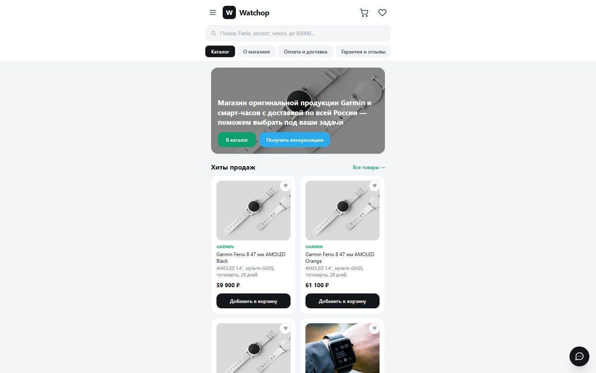
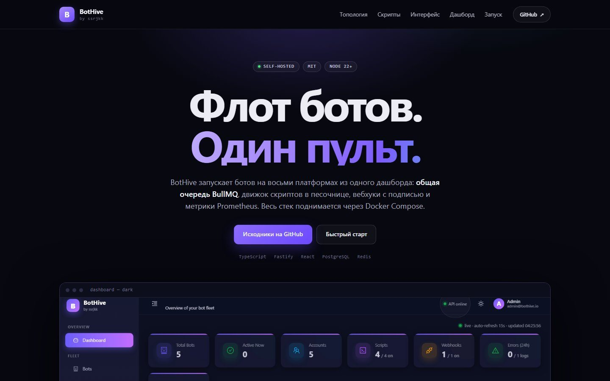
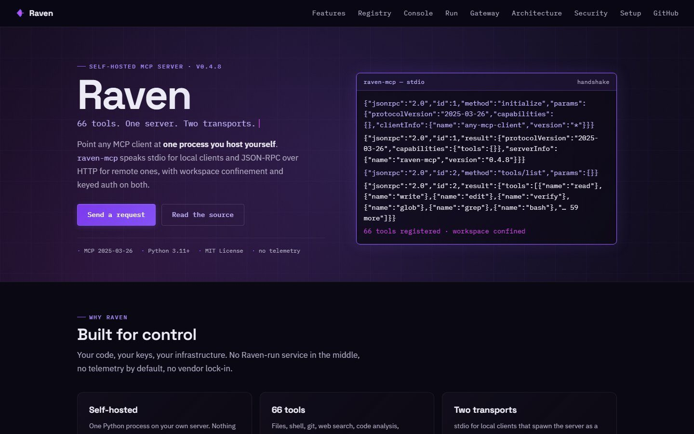
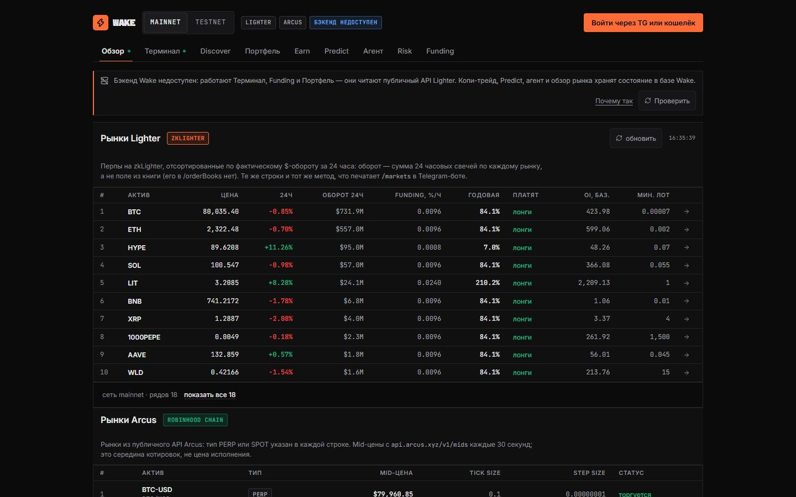
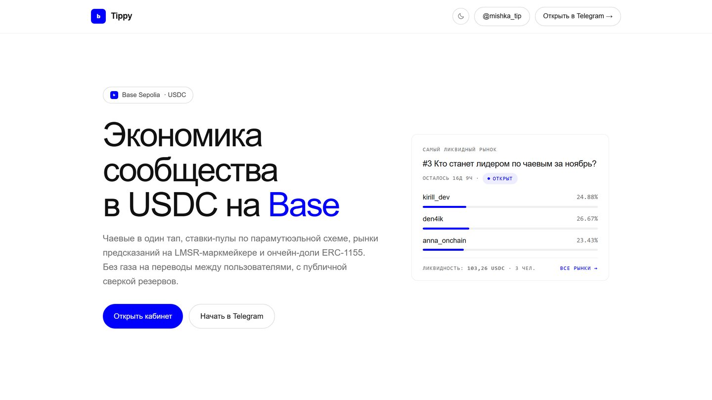
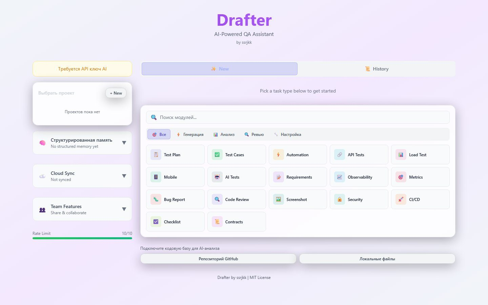
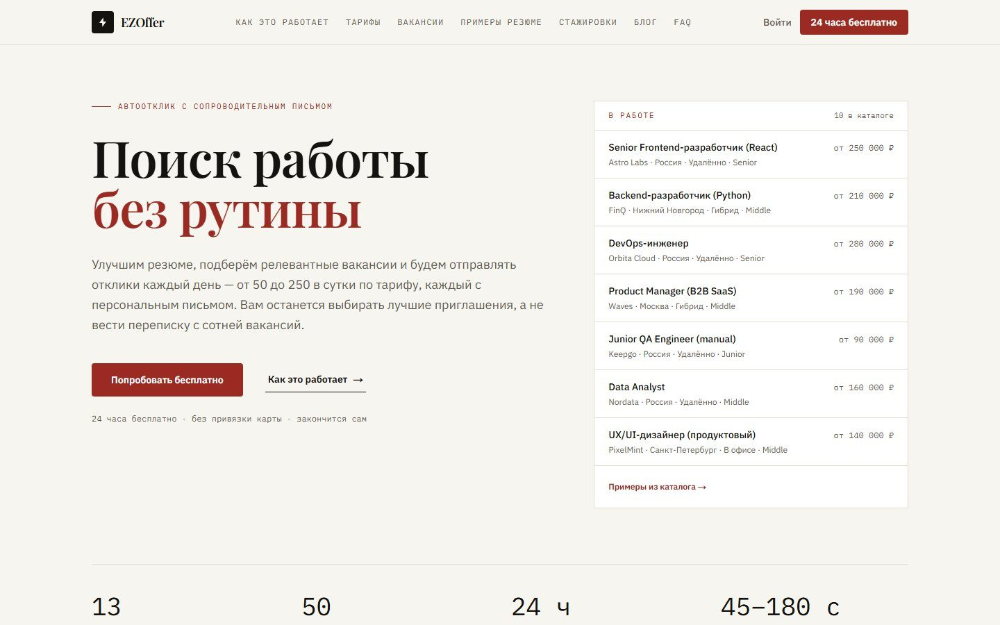
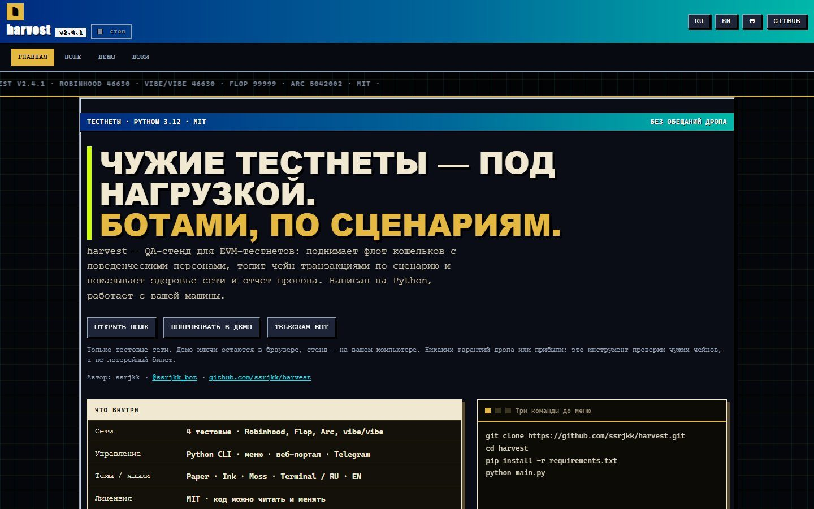
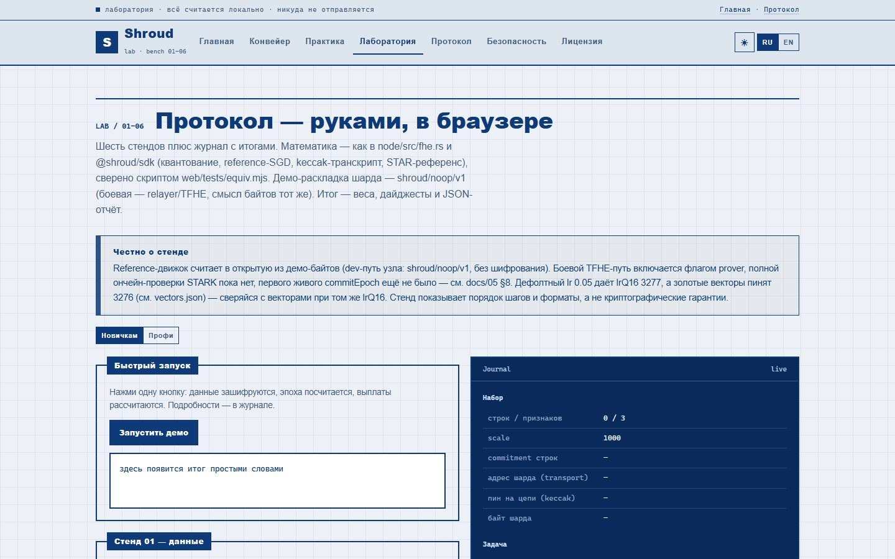
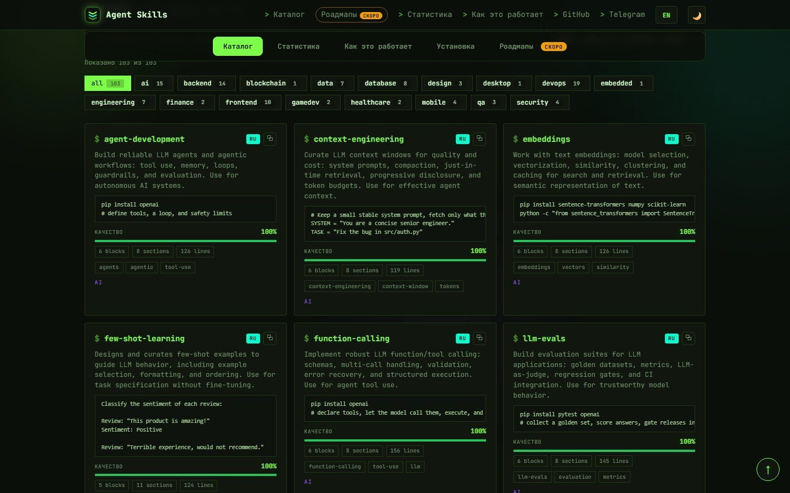

# Sergey Sitnikov

**Backend engineer · Telegram bots · Web3 · AI tooling**

[GitHub](https://github.com/ssrjkk) · [Telegram](https://t.me/ssrjkk) · [Bot catalogue](https://t.me/ssrjkk_bot) · [Projects hub](https://ssrjkk.github.io/)

---

I build and operate web services, Telegram bots and QA tooling. Python and TypeScript first: FastAPI, aiogram, React, PostgreSQL, Redis, Docker, GitHub Actions. Every public project below is one I can open, run and show — screenshots are taken from the live interfaces, not from mockups.

21 repositories, all public; 11 live sites (this hub included), 5 Telegram bots, plus QA, load-testing and engineering tools. Source for every project is on [GitHub](https://github.com/ssrjkk).

## Live projects

<table>
<tr>
<td width="50%" valign="top">

**shopwatch — Watchop store**

Watch store with 346 products: catalog with search, filters, cart, checkout, deep-link orders into a Telegram or MAX bot.

JavaScript · Node.js · Telegram / MAX bots · GitHub Pages

[Site](https://ssrjkk.github.io/shopwatch/) · [Bot](https://t.me/wwwatchshop_bot) · [Source](https://github.com/ssrjkk/shopwatch)
</td>
<td width="50%" valign="top">

**bothive — bot fleet control**

Self-hosted orchestration for bots on eight platforms: BullMQ queues, sandboxed script engine, webhooks, Prometheus metrics.

TypeScript · Fastify · React · Redis · PostgreSQL

[Site](https://ssrjkk.github.io/bothive/) · [Source](https://github.com/ssrjkk/bothive)
</td>
</tr>
<tr>
<td width="50%" valign="top">

**raven — self-hosted MCP server**

66 tools over stdio and HTTP, workspace confinement and keyed auth. One process you host yourself, MIT licensed.

Python · FastAPI · MCP · Rust / Go

[Site](https://ssrjkk.github.io/raven/) · [Docs](https://ssrjkk.github.io/raven/docs/) · [Source](https://github.com/ssrjkk/raven)
</td>
<td width="50%" valign="top">

**wake — multi-venue trading terminal**

Lighter and Arcus perp markets, funding, portfolio, copy trading, Predict and an AI agent. React frontend, FastAPI backend, Telegram bot.

React · FastAPI · PostgreSQL · Telegram bot

[Site](https://wake-7k6.pages.dev) · [Bot](https://t.me/waketrade_bot) · [Source](https://github.com/ssrjkk/wake)
</td>
</tr>
<tr>
<td width="50%" valign="top">

**tippy-on-base — USDC economy in Telegram**

Tips, donation pages, LMSR prediction markets and a Mini App on Base. Zero gas for users, proof of reserves on the dashboard. The Pages site is down right now; the bot works.

Python · aiogram · Base / USDC · Mini App

[Site](https://tippy-egi.pages.dev) · [Bot](https://t.me/tippy_on_base_bot) · [Source](https://github.com/ssrjkk/tippy-on-base)
</td>
<td width="50%" valign="top">

**drafter — AI QA assistant**

Browser app that turns a task description into a test plan, test cases, automation code and bug reports. Nine providers, bring your own key.

TypeScript · React · 9 AI providers

[Site](https://ssrjkk.github.io/drafter/) · [Source](https://github.com/ssrjkk/drafter)
</td>
</tr>
<tr>
<td width="50%" valign="top">

**ezzoffer — job search automation for hh.ru**

Vacancy matching, cover letters, resume management and Telegram notifications. Next.js app with a documented provider layer.

TypeScript · Next.js · hh.ru API

[Site](https://ssrjkk.github.io/ezzoffer/) · [Source](https://github.com/ssrjkk/ezzoffer)
</td>
<td width="50%" valign="top">

**harvest — QA stand for EVM testnets**

Wallet fleet, scenarios, network health and run reports for public testnets. Testnets only, plus a Telegram bot for the operator.

Python · EVM testnets · Telegram bot

[Site](https://ssrjkk.github.io/harvest/) · [Source](https://github.com/ssrjkk/harvest)
</td>
</tr>
<tr>
<td width="50%" valign="top">

**shroud — FHE research prototype**

Training over encrypted data on an fhEVM app chain: escrow-backed tasks, STARK proof of compute, streaming payouts, threshold decryption. Research code, not audited.

Solidity · TypeScript · Rust · fhEVM

[Site](https://ssrjkk.github.io/shroud/) · [Source](https://github.com/ssrjkk/shroud)
</td>
<td width="50%" valign="top">

**agent-skills — skills for AI agents**

100+ curated bilingual (EN/RU) skills in the Agent Skills format for Claude Code, OpenCode, Cursor and Windsurf, plus a Python SDK and CLI with CI-enforced validation.

Python · Agent Skills · SDK / CLI

[Site](https://ssrjkk.github.io/agent-skills/) · [Source](https://github.com/ssrjkk/agent-skills)
</td>
</tr>
</table>

## Telegram bots

| Bot | What it does |
|-----|--------------|
| [@ssrjkk_bot](https://t.me/ssrjkk_bot) | Project catalogue: `/projects`, `/sites`, `/bots`, `/top`, `/search`, screenshots, RU/EN. Runs on Cloudflare Workers. |
| [@wwwatchshop_bot](https://t.me/wwwatchshop_bot) | Watchop orders from the storefront; the MAX twin covers MAX users. |
| [@waketrade_bot](https://t.me/waketrade_bot) | Market cards, funding and the Lighter terminal link. |
| [@tippy_on_base_bot](https://t.me/tippy_on_base_bot) | Tips, donation pages, prediction markets and the Mini App. |
| [@harvest_testnet_bot](https://t.me/harvest_testnet_bot) | Testnet stand status and operator commands. |

## All sites

- [ssrjkk.github.io](https://ssrjkk.github.io/) — services and live project hub
- [shopwatch](https://ssrjkk.github.io/shopwatch/) — watch store
- [bothive](https://ssrjkk.github.io/bothive/) — bot orchestration platform
- [raven](https://ssrjkk.github.io/raven/) — MCP server site and [docs](https://ssrjkk.github.io/raven/docs/)
- [wake](https://wake-7k6.pages.dev) — trading terminal
- [tippy](https://tippy-egi.pages.dev) — USDC economy on Base; the Pages site is down right now, the bot works
- [drafter](https://ssrjkk.github.io/drafter/) — AI QA assistant
- [ezzoffer](https://ssrjkk.github.io/ezzoffer/) — hh.ru automation
- [harvest](https://ssrjkk.github.io/harvest/) — EVM testnet QA stand
- [shroud](https://ssrjkk.github.io/shroud/) — FHE research site
- [agent-skills](https://ssrjkk.github.io/agent-skills/) — skills catalog

## Engineering tools

| Project | Description | Stack |
|---------|-------------|-------|
| [qualix](https://github.com/ssrjkk/qualix) | QA automation platform: 317 tests across six layers, 85%+ coverage, security hardening, k8s-ready. | Python, FastAPI, pytest, Playwright, Locust |
| [qa-arsenal](https://github.com/ssrjkk/qa-arsenal) | QA monorepo for hh.ru API/UI, guap.ru Python/Go and amoCRM: API, UI, load, DB and Kafka suites. | Python, Go, Playwright, Kafka |
| [mobius](https://github.com/ssrjkk/mobius) | Mobile test automation for Android and iOS: 947 tests, 99% coverage, screen objects, device pooling. | Python, Appium 2.x, pytest |
| [noema](https://github.com/ssrjkk/noema) | Neuro-symbolic engineering: an LLM proposes solutions, Z3 verifies them, incidents are fixed through pull requests. | Python, Z3, gRPC |
| [volley](https://github.com/ssrjkk/volley) | Load-testing platform: C++20 async core, YAML scenarios, OAuth2/mTLS/Vault, OTLP and Prometheus, Python SDK. | C++20, Boost.Beast, gRPC |
| [port](https://github.com/ssrjkk/port) | The source of [@ssrjkk_bot](https://t.me/ssrjkk_bot): Cloudflare Worker, D1 and KV, bilingual catalogue. | JavaScript, Cloudflare Workers |
| [b2w-crypto-tg-bot](https://github.com/ssrjkk/b2w-crypto-tg-bot) | Telegram crypto platform: portfolio tracking, price monitoring and alerts. | Python, aiogram, PostgreSQL |
| [tt_bot](https://github.com/ssrjkk/tt_bot) | Telegram bot for university lab management: submissions, reports and grading. | Python, aiogram |
| [twinby-swipe-bot](https://github.com/ssrjkk/twinby-swipe-bot) | Telegram swipe bot for content discovery, with Android/iOS/macOS automation. | Python, Telegram |
| [ssrjkk.github.io](https://github.com/ssrjkk/ssrjkk.github.io) | The project hub and services site. | HTML, CSS |

## Stack

Python · TypeScript · Go · Rust · C++ · Solidity · FastAPI · aiogram · React · Node.js · PostgreSQL · Redis · Kafka · Docker · Kubernetes · GitHub Actions · Playwright · pytest · Prometheus

## Contact

- GitHub: [github.com/ssrjkk](https://github.com/ssrjkk)
- Telegram: [@ssrjkk](https://t.me/ssrjkk)
- Channels: [@b2wmain](https://t.me/b2wmain), [@b2wshitpost](https://t.me/b2wshitpost)
- Email: [ray013lefe@gmail.com](mailto:ray013lefe@gmail.com)

---

## Русский

**Сергей Ситников** — backend-инженер: Telegram-боты, интернет-магазины с ботами, Web3 и QA-платформы. Пишу на Python и TypeScript, покрываю тестами, деплою в Docker и показываю живые интерфейсы, а не макеты.

- Каталог проектов в Telegram: [@ssrjkk_bot](https://t.me/ssrjkk_bot)
- Все проекты и ссылки: [ssrjkk.github.io](https://ssrjkk.github.io/)
- Связь: [@ssrjkk](https://t.me/ssrjkk)

21 репозиторий, все открыты: 11 живых сайтов вместе с этим хабом, 5 Telegram-ботов, остальное — QA-платформы, нагрузочное тестирование и инженерные инструменты.
