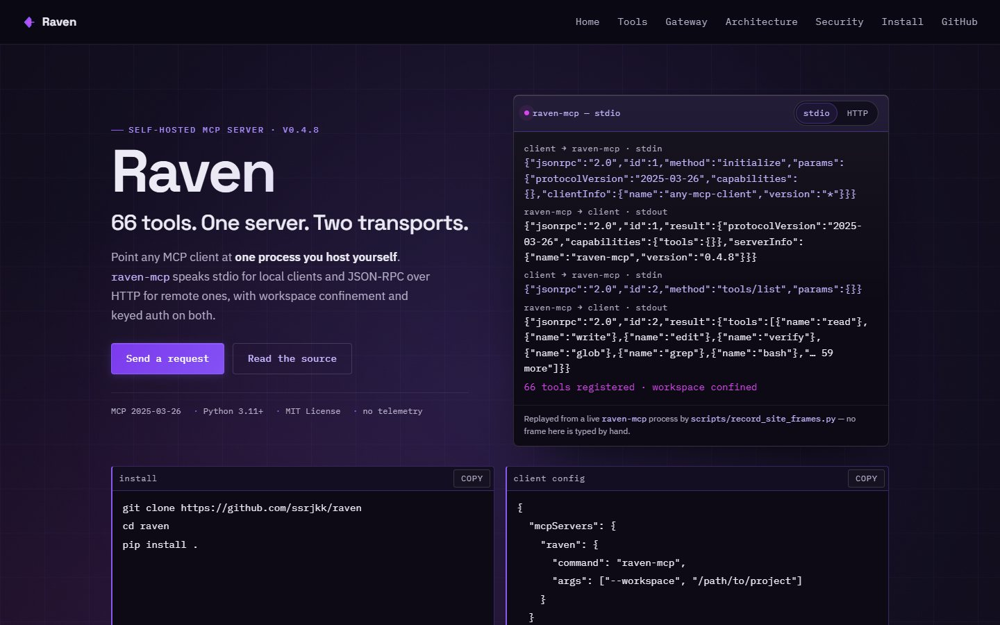
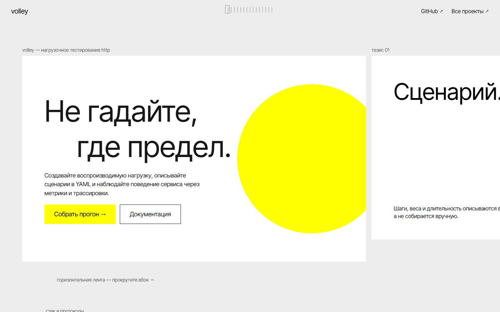

# Sergey Sitnikov

**Full-stack product engineer · Telegram bots · Web3 · AI tooling**

[GitHub](https://github.com/ssrjkk) · [Telegram](https://t.me/ssrjkk) · [Bot catalogue](https://t.me/ssrjkk_bot) · [Projects hub](https://ssrjkk.github.io/) · [Русский](README.ru.md)

---

I build and operate web services, Telegram bots and internal tools. Python and TypeScript first, with C++, Go and Rust where the problem needs them. Every project has a live interface or bot, source code and tests.

**22 live sites · 5 Telegram bots · screenshots from real interfaces**

## Featured projects

<table>
<tr>
<td width="50%" valign="top">

**Raven — self-hosted MCP server**

66 tools over stdio and HTTP, workspace confinement and keyed auth. One process you host yourself, MIT licensed.

Python · FastAPI · MCP · Rust / Go

[Site](https://ssrjkk.github.io/raven/) · [Docs](https://ssrjkk.github.io/raven/docs/) · [Source](https://github.com/ssrjkk/raven)
</td>
<td width="50%" valign="top">

**Noema — neuro-symbolic engineering**

An LLM proposes a solution, Z3 verifies it against formal contracts, and the candidate runs in a sandbox. Incidents become verified pull requests.

Python · Z3 · FastAPI · gRPC

[Site](https://ssrjkk.github.io/noema/) · [Showcase](https://ssrjkk.github.io/noema/showcase/) · [Atlas](https://ssrjkk.github.io/noema/atlas.html) · [Guide](https://github.com/ssrjkk/noema/blob/main/docs/usage-guide.md) · [Whitepaper](https://github.com/ssrjkk/noema/blob/main/docs/WHITEPAPER.md) · [Source](https://github.com/ssrjkk/noema)
</td>
</tr>
<tr>
<td width="50%" valign="top">

**Wake — multi-venue trading terminal**

Lighter and Arcus perp markets, funding, portfolio and risk tools, copy trading, Predict and an AI agent. React frontend, FastAPI backend, Telegram bot.

React · FastAPI · PostgreSQL · Telegram

[Site](https://wake-7k6.pages.dev) · [Bot](https://t.me/waketrade_bot) · [Source](https://github.com/ssrjkk/wake)
</td>
<td width="50%" valign="top">

**Volley — HTTP load-testing platform**

C++20 async core, YAML scenarios, OAuth2/mTLS/Vault, OTLP and Prometheus, plus a Python SDK.

C++20 · Boost.Beast · gRPC · Python

[Site](https://ssrjkk.github.io/volley/) · [Showcase](https://ssrjkk.github.io/volley/showcase/) · [Architecture](https://github.com/ssrjkk/volley/blob/main/docs/architecture.md) · [Source](https://github.com/ssrjkk/volley)
</td>
</tr>
</table>

## Products and bots

- **Bothive** — self-hosted bot orchestration with BullMQ, sandboxed scripts and Prometheus. [Site](https://ssrjkk.github.io/bothive/) · [Source](https://github.com/ssrjkk/bothive)
- **Tippy** — USDC economy in Telegram: tips, donation pages, prediction markets and a Base Mini App. [Bot](https://t.me/tippy_on_base_bot) · [Site](https://tippy-egi.pages.dev/) · [Source](https://github.com/ssrjkk/tippy-on-base)
- **Drafter** — browser AI QA assistant: test plans, cases, automation code and bug reports. [Site](https://ssrjkk.github.io/drafter/) · [Source](https://github.com/ssrjkk/drafter)
- **EZOffer** — hh.ru job-search automation with vacancy matching, cover letters and Telegram alerts. [Site](https://ssrjkk.github.io/ezzoffer/) · [Bot](https://t.me/ezzoffer_bot) · [Source](https://github.com/ssrjkk/ezzoffer)
- **Harvest** — QA stand for EVM testnets: wallet fleet, scenarios, network health and run reports. [Site](https://ssrjkk.github.io/harvest/) · [Bot](https://t.me/harvest_testnet_bot) · [Source](https://github.com/ssrjkk/harvest)
- **Corvid CRM** — deals, invoices, clients, tasks and analytics for freelance work. [Site](https://ssrjkk.github.io/corvid_crm/) · [Source](https://github.com/ssrjkk/corvid_crm)
- **Verso** — editorial headless CMS with collections, revisions and a block page builder. [Site](https://ssrjkk.github.io/verso/) · [Source](https://github.com/ssrjkk/verso)
- **B2W Crypto** — Telegram crypto portfolio tracking, price monitoring and alerts. [Site](https://ssrjkk.github.io/b2w-crypto-tg-bot/) · [Source](https://github.com/ssrjkk/b2w-crypto-tg-bot)
- **TT Bot** — HTTP/HTTPS, SSL and TCP monitoring from Telegram with SLA history and CSV export. [Site](https://ssrjkk.github.io/tt_bot/) · [Showcase](https://ssrjkk.github.io/tt_bot/showcase/) · [Source](https://github.com/ssrjkk/tt_bot)
- **Heart3** — dating agent with screen vision, browser vision and experimental API clients. [Site](https://ssrjkk.github.io/twinby-swipe-bot/) · [Source](https://github.com/ssrjkk/twinby-swipe-bot)

## Engineering and research

- **Agent Skills** — 120 bilingual skills, 20 IT roadmaps, 25 guides, CLI and Python SDK. [Site](https://ssrjkk.github.io/agent-skills/) · [Registry](https://ssrjkk.github.io/agent-skills/skills_catalog.json) · [Roadmaps](https://ssrjkk.github.io/agent-skills/roadmaps.html) · [Guides](https://ssrjkk.github.io/agent-skills/guides.html) · [Source](https://github.com/ssrjkk/agent-skills)
- **Qualix** — QA automation platform with API, UI, load and security layers. [Site](https://ssrjkk.github.io/qualix/) · [Source](https://github.com/ssrjkk/qualix)
- **QA Arsenal** — API, UI, load, DB and Kafka suites for hh.ru, guap.ru and amoCRM. [Site](https://ssrjkk.github.io/qa-arsenal/) · [Source](https://github.com/ssrjkk/qa-arsenal)
- **Mobius** — Android and iOS automation with Appium, pytest and device pooling. [Site](https://ssrjkk.github.io/mobius/) · [Source](https://github.com/ssrjkk/mobius)
- **Shroud** — research prototype for ML training over encrypted data with fhEVM and STARK proofs; not audited. [Site](https://ssrjkk.github.io/shroud/) · [Source](https://github.com/ssrjkk/shroud)
- **Projects hub** — all live interfaces, screenshots, bots and contacts in one place. [Hub](https://ssrjkk.github.io/) · [Catalogue bot](https://t.me/ssrjkk_bot) · [Source](https://github.com/ssrjkk/ssrjkk.github.io)

## Commerce

- **Fruktovy** — fruit and vegetable storefront with search, basket, 3D crate builder and Telegram ordering. [Site](https://ssrjkk.github.io/fruktovy/) · [Source](https://github.com/ssrjkk/fruktovy)
- **Our Jamon** — delicatessen storefront; demo mode until prices and live payments are confirmed. [Site](https://ssrjkk.github.io/our-jamon/) · [Source](https://github.com/ssrjkk/our-jamon)

All documentation, changelogs and showcases

- **Bothive:** [API](https://github.com/ssrjkk/bothive/blob/main/docs/api.md) · [ADR](https://github.com/ssrjkk/bothive/blob/main/docs/adr/README.md) · [Deploy](https://github.com/ssrjkk/bothive/blob/main/docs/deployment.md)
- **Fruktovy:** [Deploy](https://github.com/ssrjkk/fruktovy/blob/main/AGENT_DEPLOY.md)
- **Our Jamon:** [Releases](https://github.com/ssrjkk/our-jamon/blob/main/RELEASE.md) · [Shop guide](https://github.com/ssrjkk/our-jamon/blob/main/shop/README.md)
- **Raven:** [Security](https://ssrjkk.github.io/raven/security.html) · [Changelog](https://github.com/ssrjkk/raven/blob/main/CHANGELOG.md)
- **Wake:** [Whitepaper](https://github.com/ssrjkk/wake/blob/main/WHITEPAPER.md) · [Changelog](https://github.com/ssrjkk/wake/blob/main/CHANGELOG.md) · [Deploy](https://github.com/ssrjkk/wake/blob/main/docs/RAILWAY_DEPLOY.md)
- **Tippy:** [Whitepaper](https://github.com/ssrjkk/tippy-on-base/blob/main/docs/WHITEPAPER.md) · [User guide](https://github.com/ssrjkk/tippy-on-base/blob/main/docs/USER_GUIDE.md) · [Security](https://github.com/ssrjkk/tippy-on-base/blob/main/SECURITY.md)
- **Drafter:** [Changelog](https://github.com/ssrjkk/drafter/blob/main/CHANGELOG.md) · [Security](https://github.com/ssrjkk/drafter/blob/main/SECURITY.md)
- **EZOffer:** [About](https://ssrjkk.github.io/ezzoffer/about) · [FAQ](https://ssrjkk.github.io/ezzoffer/faq) · [Pricing](https://ssrjkk.github.io/ezzoffer/pricing)
- **Harvest:** [Docs](https://ssrjkk.github.io/harvest/docs.html) · [Demo](https://ssrjkk.github.io/harvest/demo.html) · [Changelog](https://github.com/ssrjkk/harvest/blob/main/CHANGELOG.md)
- **Shroud:** [Protocol](https://ssrjkk.github.io/shroud/protocol.html) · [Security](https://ssrjkk.github.io/shroud/security.html) · [User guide](https://github.com/ssrjkk/shroud/blob/main/USER_GUIDE.md)
- **Agent Skills:** [Architecture](https://github.com/ssrjkk/agent-skills/blob/main/docs/ARCHITECTURE.md)
- **Qualix:** [ADR](https://github.com/ssrjkk/qualix/blob/main/docs/adr/README.md) · [Changelog](https://github.com/ssrjkk/qualix/blob/main/CHANGELOG.md)
- **QA Arsenal:** [Showcase](https://ssrjkk.github.io/qa-arsenal/showcase/)
- **Mobius:** [Usage](https://github.com/ssrjkk/mobius/blob/main/docs/USAGE.md) · [Showcase](https://ssrjkk.github.io/mobius/showcase/) · [Changelog](https://github.com/ssrjkk/mobius/blob/main/CHANGELOG.md)
- **B2W Crypto:** [Showcase](https://ssrjkk.github.io/b2w-crypto-tg-bot/showcase/) · [API](https://github.com/ssrjkk/b2w-crypto-tg-bot/blob/main/docs/api_reference.md) · [Deploy](https://github.com/ssrjkk/b2w-crypto-tg-bot/blob/main/docs/deployment.md)
- **TT Bot:** [Architecture](https://github.com/ssrjkk/tt_bot/blob/main/ARCHITECTURE.md)
- **Heart3:** [Integration guide](https://github.com/ssrjkk/twinby-swipe-bot/blob/main/AGENT_INTEGRATION_GUIDE.md) · [Security](https://github.com/ssrjkk/twinby-swipe-bot/blob/main/SECURITY.md)
- **Verso:** [Decisions](https://github.com/ssrjkk/verso/blob/main/docs/DECISIONS.md) · [Deploy](https://github.com/ssrjkk/verso/blob/main/docs/DEPLOYMENT.md)

## Telegram

[@ssrjkk_bot](https://t.me/ssrjkk_bot) · [@waketrade_bot](https://t.me/waketrade_bot) · [@tippy_on_base_bot](https://t.me/tippy_on_base_bot) · [@ezzoffer_bot](https://t.me/ezzoffer_bot) · [@harvest_testnet_bot](https://t.me/harvest_testnet_bot)

## Stack and contact

Python · TypeScript · Go · Rust · C++ · Solidity · FastAPI · aiogram · React · Node.js · PostgreSQL · Redis · Kafka · Docker · Kubernetes · GitHub Actions · Playwright · pytest · Prometheus

[GitHub](https://github.com/ssrjkk) · [Telegram](https://t.me/ssrjkk) · [B2W Main](https://t.me/b2wmain) · [B2W Shitpost](https://t.me/+zxyfRXblOINkNjNi) · [Email](mailto:ray013lefe@gmail.com)
