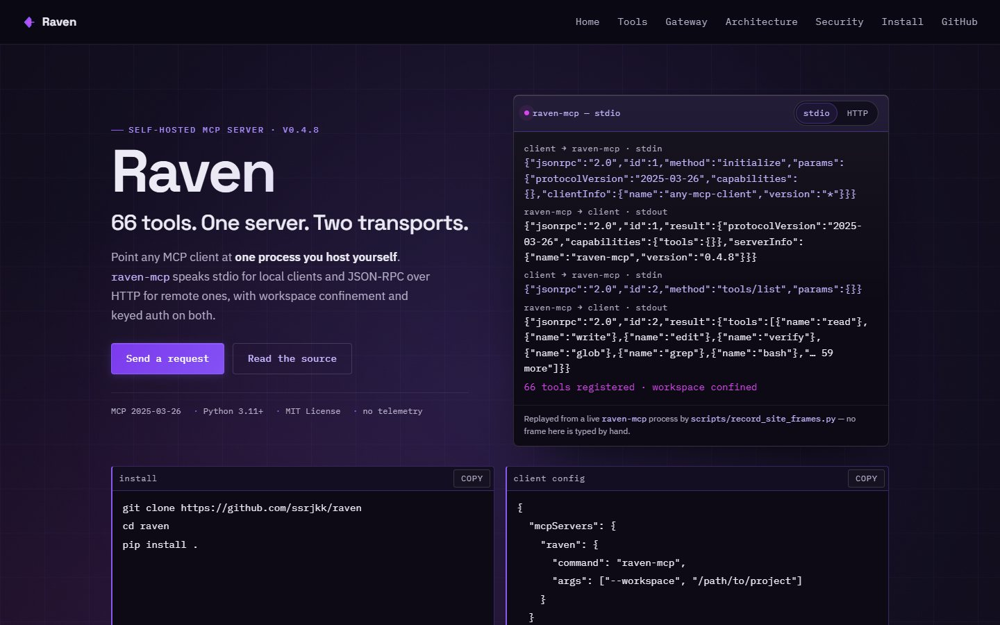
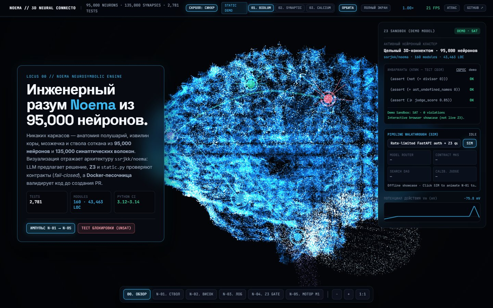
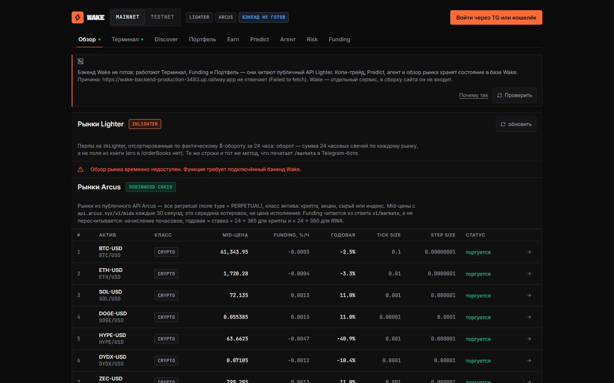
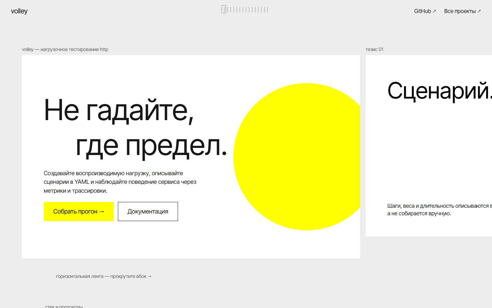

# Сергей Ситников

> **Языки:** [English](README.md) · [Русский](README.ru.md)

Фулстек-инженер: веб-сервисы, Telegram-боты, Mini Apps, Web3 и AI-инструменты.
Python и TypeScript — основные языки; C++, Go и Rust использую там, где этого
требует задача.

[GitHub](https://github.com/ssrjkk) · [Telegram](https://t.me/ssrjkk) · [Каталог-бот](https://t.me/ssrjkk_bot) · [Хаб проектов](https://ssrjkk.github.io/)

22 живых сайта, 5 Telegram-ботов. Скриншоты сняты с реальных интерфейсов.

## Главные проекты

| Raven | Noema |
| --- | --- |
|  |  |
| Self-hosted MCP server: 66 инструментов, stdio/HTTP, изоляция workspace и ключ-аутентификация. [Сайт](https://ssrjkk.github.io/raven/) · [Доки](https://ssrjkk.github.io/raven/docs/) · [Код](https://github.com/ssrjkk/raven) | LLM предлагает решение, Z3 проверяет контракт, кандидат выполняется в песочнице. [Сайт](https://ssrjkk.github.io/noema/) · [Showcase](https://ssrjkk.github.io/noema/showcase/) · [Код](https://github.com/ssrjkk/noema) |

| Wake | Volley |
| --- | --- |
|  |  |
| Multi-venue терминал: Lighter и Arcus, copy trading, Predict и AI-агент. [Сайт](https://wake-7k6.pages.dev) · [Бот](https://t.me/waketrade_bot) · [Код](https://github.com/ssrjkk/wake) | C++20 async core, YAML-сценарии, OAuth2/mTLS/Vault, OTLP и Prometheus. [Сайт](https://ssrjkk.github.io/volley/) · [Showcase](https://ssrjkk.github.io/volley/showcase/) · [Код](https://github.com/ssrjkk/volley) |

## Продукты и боты

- **Bothive** — оркестрация ботов на BullMQ, песочница сценариев и Prometheus. [Сайт](https://ssrjkk.github.io/bothive/) · [Код](https://github.com/ssrjkk/bothive)
- **Tippy** — USDC-экономика в Telegram: чаевые, донаты, рынки и Base Mini App. [Бот](https://t.me/tippy_on_base_bot) · [Сайт](https://tippy-egi.pages.dev/) · [Код](https://github.com/ssrjkk/tippy-on-base)
- **Drafter** — AI QA-ассистент в браузере: планы, кейсы, код автоматизации и баг-репорты. [Сайт](https://ssrjkk.github.io/drafter/) · [Код](https://github.com/ssrjkk/drafter)
- **EZOffer** — автоматизация поиска работы на hh.ru. [Сайт](https://ssrjkk.github.io/ezzoffer/) · [Бот](https://t.me/ezzoffer_bot) · [Код](https://github.com/ssrjkk/ezzoffer)
- **Harvest** — QA-стенд для EVM-тестнетов. [Сайт](https://ssrjkk.github.io/harvest/) · [Бот](https://t.me/harvest_testnet_bot) · [Код](https://github.com/ssrjkk/harvest)
- **Corvid CRM** — сделки, счета, клиенты, задачи и аналитика для фриланса. [Сайт](https://ssrjkk.github.io/corvid_crm/) · [Код](https://github.com/ssrjkk/corvid_crm)
- **Verso** — редакционный headless CMS с ревизиями и block page builder. [Сайт](https://ssrjkk.github.io/verso/) · [Код](https://github.com/ssrjkk/verso)
- **B2W Crypto** — Telegram-бот для портфеля, цен и алертов. [Сайт](https://ssrjkk.github.io/b2w-crypto-tg-bot/) · [Код](https://github.com/ssrjkk/b2w-crypto-tg-bot)
- **TT Bot** — HTTP/SSL/TCP мониторинг из Telegram. [Сайт](https://ssrjkk.github.io/tt_bot/) · [Showcase](https://ssrjkk.github.io/tt_bot/showcase/) · [Код](https://github.com/ssrjkk/tt_bot)
- **Heart3** — дейтинг-агент с UI/web vision и экспериментальными API-адаптерами. [Сайт](https://ssrjkk.github.io/twinby-swipe-bot/) · [Код](https://github.com/ssrjkk/twinby-swipe-bot)

## Инженерия и исследования

- **Agent Skills** — 120 двуязычных навыков, 20 roadmaps, руководства, CLI и Python SDK. [Сайт](https://ssrjkk.github.io/agent-skills/) · [Код](https://github.com/ssrjkk/agent-skills)
- **Qualix** — QA-автоматизация: API, UI, load и security. [Сайт](https://ssrjkk.github.io/qualix/) · [Код](https://github.com/ssrjkk/qualix)
- **QA Arsenal** — API/UI/load/DB/Kafka наборы для hh.ru, guap.ru и amoCRM. [Сайт](https://ssrjkk.github.io/qa-arsenal/) · [Код](https://github.com/ssrjkk/qa-arsenal)
- **Mobius** — Android/iOS автоматизация на Appium и pytest. [Сайт](https://ssrjkk.github.io/mobius/) · [Код](https://github.com/ssrjkk/mobius)
- **Shroud** — исследовательский прототип ML над зашифрованными данными; не аудирован. [Сайт](https://ssrjkk.github.io/shroud/) · [Код](https://github.com/ssrjkk/shroud)
- **Хаб проектов** — все сайты, скриншоты, боты и контакты. [Хаб](https://ssrjkk.github.io/) · [Код](https://github.com/ssrjkk/ssrjkk.github.io)

## Коммерция

- **Fruktovy** — витрина фруктов и овощей с поиском, корзиной и заказом в Telegram. [Сайт](https://ssrjkk.github.io/fruktovy/) · [Код](https://github.com/ssrjkk/fruktovy)
- **Our Jamon** — витрина деликатесов; демо-режим до подтверждения цен и оплаты. [Сайт](https://ssrjkk.github.io/our-jamon/) · [Код](https://github.com/ssrjkk/our-jamon)

Документация, changelog и showcase

- **Raven:** [Security](https://ssrjkk.github.io/raven/security.html) · [Changelog](https://github.com/ssrjkk/raven/blob/main/CHANGELOG.md)
- **Noema:** [Atlas](https://ssrjkk.github.io/noema/atlas.html) · [Guide](https://github.com/ssrjkk/noema/blob/main/docs/usage-guide.md) · [Whitepaper](https://github.com/ssrjkk/noema/blob/main/docs/WHITEPAPER.md)
- **Wake:** [Whitepaper](https://github.com/ssrjkk/wake/blob/main/WHITEPAPER.md) · [Deploy](https://github.com/ssrjkk/wake/blob/main/docs/RAILWAY_DEPLOY.md)
- **Tippy:** [Whitepaper](https://github.com/ssrjkk/tippy-on-base/blob/main/docs/WHITEPAPER.md) · [User guide](https://github.com/ssrjkk/tippy-on-base/blob/main/docs/USER_GUIDE.md)
- **Bothive:** [API](https://github.com/ssrjkk/bothive/blob/main/docs/api.md) · [Deploy](https://github.com/ssrjkk/bothive/blob/main/docs/deployment.md)
- **Shroud:** [Protocol](https://ssrjkk.github.io/shroud/protocol.html) · [Security](https://ssrjkk.github.io/shroud/security.html)
- **Agent Skills:** [Architecture](https://github.com/ssrjkk/agent-skills/blob/main/docs/ARCHITECTURE.md)
- **Mobius:** [Usage](https://github.com/ssrjkk/mobius/blob/main/docs/USAGE.md) · [Showcase](https://ssrjkk.github.io/mobius/showcase/)
- **Verso:** [Decisions](https://github.com/ssrjkk/verso/blob/main/docs/DECISIONS.md) · [Deploy](https://github.com/ssrjkk/verso/blob/main/docs/DEPLOYMENT.md)

## Telegram

[@ssrjkk_bot](https://t.me/ssrjkk_bot) · [@waketrade_bot](https://t.me/waketrade_bot) · [@tippy_on_base_bot](https://t.me/tippy_on_base_bot) · [@ezzoffer_bot](https://t.me/ezzoffer_bot) · [@harvest_testnet_bot](https://t.me/harvest_testnet_bot)

## Стек и контакты

Python · TypeScript · Go · Rust · C++ · Solidity · FastAPI · aiogram · React · Node.js · PostgreSQL · Redis · Kafka · Docker · Kubernetes · GitHub Actions · Playwright · pytest · Prometheus

[GitHub](https://github.com/ssrjkk) · [Telegram](https://t.me/ssrjkk) · [Email](mailto:ray013lefe@gmail.com)
